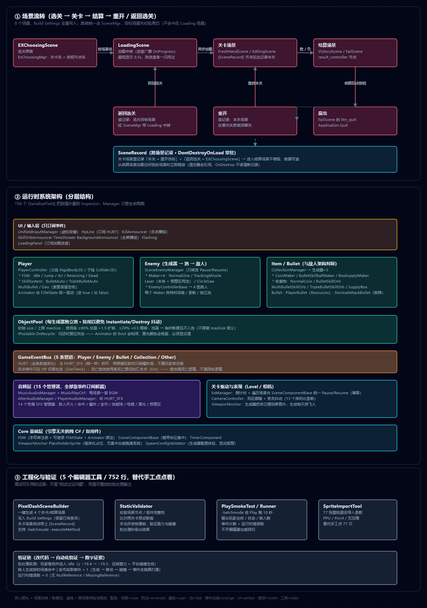

# PixelDash — 2D 横版跑酷（Cocos Creator → Unity 双引擎复刻）

一款横版跑酷/平台跳跃小游戏：选关 → 关卡（限时生存、敌人/道具/技能）→ 结算（胜利/失败）→ 重开本关或返回选关。
**同一款游戏我用两套引擎各完整实现了一遍**：先用 Cocos Creator 3.8.8（TypeScript）写原版，再逐系统复刻到 Unity 2022.3 LTS（C#），并借这次复刻做了架构升级与工程化补强。

> 🎬 **玩法演示视频**（约 1 分 40 秒）：https://www.bilibili.com/video/BV1dGJQ69E93

---

## 数据速览

| 项 | 数据 |
| :--- | :--- |
| 游戏脚本 | **86 个 / 5,484 行有效代码**（Unity C#） |
| 编辑器工具 | **4 个 / 658 行**（场景构建、静态校验、批处理冒烟测试、Sprite 批量导入） |
| 原版规模 | Cocos Creator：**103 个 TS 脚本 / 8,953 行** |
| 资产 | 6 个场景 · 14 个预制体 · 3 个 Animator Controller · 95 张 PNG（含原版 77 张 Sprite 素材）· 47 个音频 |
| 可调参数 | **156 个 `[SerializeField]`** 全部外露到 Inspector |
| 系统 | 7 个生成器 + 2 个生成器基类 · 15 个音频管理器 · 12 个敌人脚本 · 5 个技能类 |
| 文档 | 5 份：复刻规格说明书（314 行）· 组件配置（711 行）· 场景节点树（265 行）· 美术资源对照表（111 行）· 复刻进度（116 行） |



> 高清版见 `架构图@2x.png`；可编辑矢量版见 `架构图.svg` / `架构图.html`。

---

## 为什么值得用两套引擎做一遍

不是为了"会用两个引擎"，而是这次复刻逼出了三类**引擎无关**的工程判断：

1. **读别人的代码 → 写成规格 → 再实现**。我把 Cocos 原版的玩法数值、节点树、组件参数逆向成了《复刻规格说明书》，再按规格实现 Unity 版。游戏公司接手老项目时干的就是这件事。
2. **引擎差异要自己判断，不能盲抄**。例：原版 `jump_force = 30` 在 Unity 里要写 `450`——两套引擎的物理单位不同；激光生成用的 X 偏移在原版是局部坐标，Unity 里改用锚点；原版的 `ex_move_ctrl`（移动整个根节点）判定为冗余/疑似 bug，改用各系统独立移动得到等价效果。
3. **架构决策在两套引擎里都成立**：对象池、事件解耦、数据驱动生成、状态机与动画解耦——这些不是"Unity 技巧"，是系统设计。

---

## 系统架构

见上方架构图，三层展开：

**① 场景流转**：`EXChoosingScene`（选关）→ `LoadingScene`（加载中转）→ 关卡场景（`FreshHandScene` / `EditingScene`）→ 结算场景（`VictoryScene` / `FailScene`）→ 重开本关 / 返回选关 / 退出。所有跳转统一走 `SceneMgr`（异步加载 + 进度广播 + 最短显示时长），并由 `SceneRecord` 跨场景携带"本关是哪一关 / 返回选关去哪"。

**② 运行时系统**：UI·输入层（只订阅事件）→ 玩法层（Player / Enemy / Item / Bullet）→ 对象池 → 事件总线 → 音频与表现 → Core 基础层。

**③ 工程化**：4 个编辑器工具 + 批处理验证链，让"改动有没有把关卡改坏"有可重放的数字答案。

---

## 可深挖的五个技术点

### 1. 对象池：不是"加个池"，是生命周期契约
- 初始 size / 上限 `maxSize`；**使用率 ≥80% 时总量 ×1.5 扩容，≤20% 时 ×0.5 缩容**；每个生成器持**独立池**（敌人本体与激光预警区是两个预制体 → 两个池）。
- 池满策略：默认可"跳过本次生成"，我改成 **临时新建且不入池** —— 临时对象用完自行销毁，不把池的 `maxSize` 语义悄悄撑破。
- 归还时要复位状态（`IPoolable.OnRecycle`），这里踩过真实的坑：**Animator 的 Bool 会粘滞**（池化的导弹带着上一轮的爆炸状态出场）、**激光的颜色会残留**（上一轮攻击态闪到的橙红会带到下一轮预警态）。

### 2. 数据驱动的生成器体系 + 配置体检
- `EnemyMakerBase` / `CollectionMakerBase` 派生 9 个 Maker，各自持有**时间表 / 偏移表 / 参数**；Manager（`SceneEnemyManager` / `CollectionManager`）只转发 Pause/Resume，生成逻辑归 Maker；敌人属性由 Maker 注入（不是预制体自带）。
- `SpawnConfigValidator`：时间表为空 / 两表长度不匹配 / 未升序 / 缺预制体 → 启动时**显式报警**。此前这类配置错误会让生成器"完全静默地什么都不做"，只能靠人肉盯屏幕发现。

### 3. 状态机与动画解耦（而且"没做成一套"是设计）
- 玩家用 `FSM`：字符串注册、可继承 `FSMState`、进状态把对应 Animator bool 置 true / 退出置 false 由基类统一处理（子类覆写必须调 `base`）。
- 敌人用 `enum + switch`。**这不是疏漏**：玩家的状态是真状态机（互相跳转），敌人的状态更像生命周期阶段（预警 → 攻击 → 死亡），强上通用 FSM 只增加间接层。

### 4. 事件总线的语义设计
- 5 条管道（Player / Enemy / Bullet / Collection / Other）+ 事件名常量，27 个脚本通过它通信，音效/UI 全部靠订阅解耦。
- `HURT`（血条数值变化）与 `HURT_SFX`（响一声）**拆成两个事件**：导弹撞玩家时只发爆炸音、不发玩家受伤音，避免两个音效叠加。
- **击杀事件只在 HP 归零处发**（`DieCheck`），**死亡音效放在两条死亡路径的汇合点**（`Die`）——音效属于死亡逻辑，不属于回收逻辑（被池回收时不该响）。

### 5. 跨场景数据与生命周期
- `SceneRecord`：关卡场景里记录「本关 = 重开目标」+「返回选关 = 选关场景」，`DontDestroyOnLoad` 带进结算场景，**从结算场景加载任何别的场景时立即释放**（清空静态引用）。
- 处理了两个真问题：① `DontDestroyOnLoad` 只对根物体生效，挂在子节点上会**静默失效** → 自动脱父并警告；② 记录唯一性不能只按先来后到——误挂在结算场景里的空记录会顶掉真实记录 → 改为按"可靠性"取舍。
- `ResultSceneController` 从记录里读目标场景，跳转前**先校验目标是否在 Build Settings**（否则无效目标会先切进 Loading 场景、把玩家卡在加载界面）。

---

## 工程化与验证（可引用的证据）

| 工具 | 作用 |
| :--- | :--- |
| `PixelDashSceneBuilder` | 一键生成 4 个关卡/结算场景并写入 Build Settings（保留已有条目、缺场景时告警） |
| `StaticValidator` | 批处理校验场景节点/组件完整性 + 比对两关卡预设数值 + **手动步进物理帧**验证重力与碰撞是否真的生效 |
| `SmokeTestRunner` | `-batchmode -executeMethod` 进 Play 模式实跑 10 秒，输出玩家 / 生成器 / 事件流状态 |
| `SpriteImportTool` | 77 张 Sprite 批量设置导入参数（PPU / Point / 无压缩），替代手工点 77 次 |

**批处理实测输出（可直接在面试中引用）**：

```
[SmokeTest] 玩家存在=True | 血量=100 | 状态=idle | 坐标=(-335.4, -19.3, 0.0)
[SmokeTest] 已生成敌人(当前)=1 | 子弹=0 | 金币=0
[SmokeTest] 事件计数：金币拾取=1 | 敌人开火=0 | 导弹命中=0
[SmokeTest] 运行时错误数=0
```

这组数字证明的三件事：**①** 玩家落地并进入 `idle`（y 由 −19.4 稳定到 −19.3），说明重力、平台碰撞、FSM 全链路生效；**②** 金币拾取事件 = 1，说明道具全链路（生成 → 移动 → 碰撞 → 事件总线 → 音效/UI）打通；**③** 运行时错误 0，说明生成器/池化/事件系统没有空引用。

> 坑：批处理 Play 模式必须禁用 Domain Reload（`EnterPlayModeOptions.DisableDomainReload`），否则脚本域重载会清空测试回调。

---

## 与源项目的差异（诚实记录）

| 项 | Cocos 原版 | Unity 版 | 原因 |
| :--- | :--- | :--- | :--- |
| `jump_force` / `quick_down_force` | 30 / 90 | 450 / 900 | 两引擎物理单位不同 |
| 激光生成 X 偏移 | −1150（局部坐标） | 0（锚点） | 坐标系不同 |
| 敌方子弹 | 预制体 | 优先预制体，缺省程序化占位 | 美术管线不同 |
| `ex_move_ctrl` | 移动整个根节点 | 未复刻（敌人/背景各自移动） | 原版实现冗余/疑似 bug，等价效果 |
| 追踪导弹 Y 偏移 | 46 个逐点精确值 | 46 个逐点精确值 | 已对齐 |

---

## 运行方法

1. Unity Hub 打开本工程（**Unity 2022.3.62f3c1 LTS**，Built-in 渲染管线，含 2D 模块）。
2. 打开 `Assets/Scenes/FreshHandScene.unity` → **Play** → 按任意键开始（90 秒倒计时）。
3. 操作：`W/↑` 跳跃 · `S/↓` 快速下落 / 平台翻转 · `A/D` 转向。
4. 需要重建场景：菜单 **PixelDash → ① 构建全部场景**（注意：会覆盖关卡场景里手工挂载的内容）。
5. 批处理验证：`Unity.exe -batchmode -quit -projectPath "<工程>" -executeMethod PixelDash.EditorTools.StaticValidator.Validate -logFile -`

---

## 面试速讲

**30 秒版**
> 我用 Cocos Creator 和 Unity 各实现了一遍同一款 2D 跑酷游戏。Unity 版 86 个脚本、5,484 行，含对象池、状态机、事件总线、数据驱动生成器和 4 个编辑器工具；我还写了批处理冒烟测试，能在不开编辑器的情况下验证关卡可跑、运行时零错误。

**2 分钟版**：挑对象池走「问题 → 方案 → 取舍 → 验证」
> 敌人、激光、预警区后期会大量生成，直接 Instantiate/Destroy 会带来 GC 抖动和帧峰，所以做了对象池：初始 size 和上限、按使用率 ×1.5/×0.5 动态伸缩、每个生成器独立池。难点不在"复用",在生命周期：池化的导弹复用时会带着上一轮的 Animator 状态出场，激光会带着上一轮闪到的颜色，所以归还时必须显式复位。池满时我选择临时新建但不入池，避免把 maxSize 的语义撑破。验证方式是把这批类放进一个 .NET 工程桩掉 UnityEngine 真编译 + 跑运行时探针，确认扩容、池满、复用三条路径都对。

**深挖准备**：能手写 `ObjectPool.Get/Recycle`，能解释 `HURT` 与 `HURT_SFX` 为什么要拆成两个事件。

---

## 已知不足 / 后续

- 仓库历史（git）尚未建立 —— 本目录是为面试整理的材料，代码仓库待推。
- 音效通道仍有部分未接入（第一版按规格取舍）；`DaoSkill` 为废案空壳类。
- 美术与音乐素材来自原版项目（玩法、系统、架构、工具、验证为本人实现）。
- 单元测试缺位：目前用批处理验证链替代；后续计划给 `ObjectPool`、`SpawnConfigValidator` 补 EditMode 测试（这两者不依赖 Unity 生命周期，易测）。
- 性能目前只有设计层面的收益说明，尚缺 Profiler 量化对比（有/无对象池的 GC Alloc、Instantiate 次数）。
